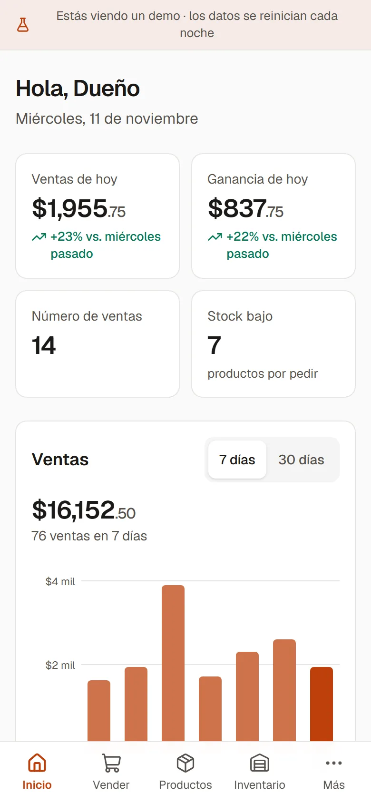
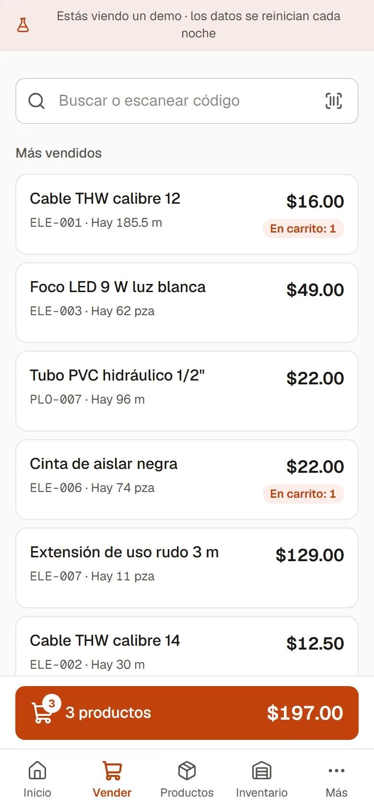
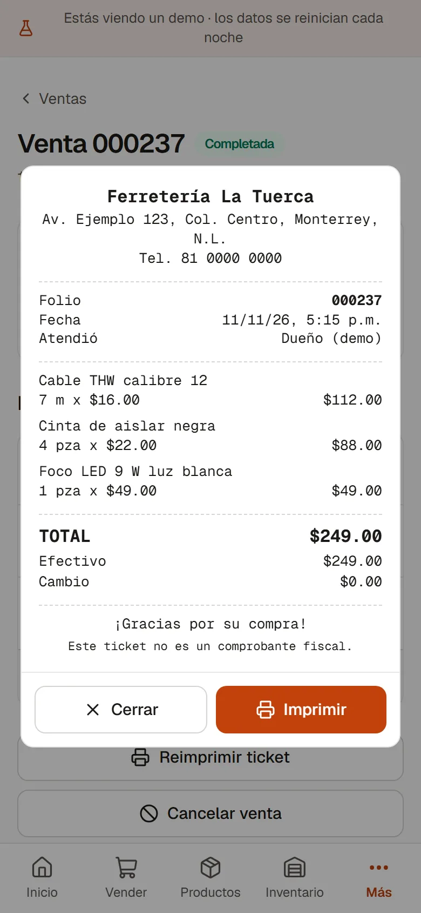
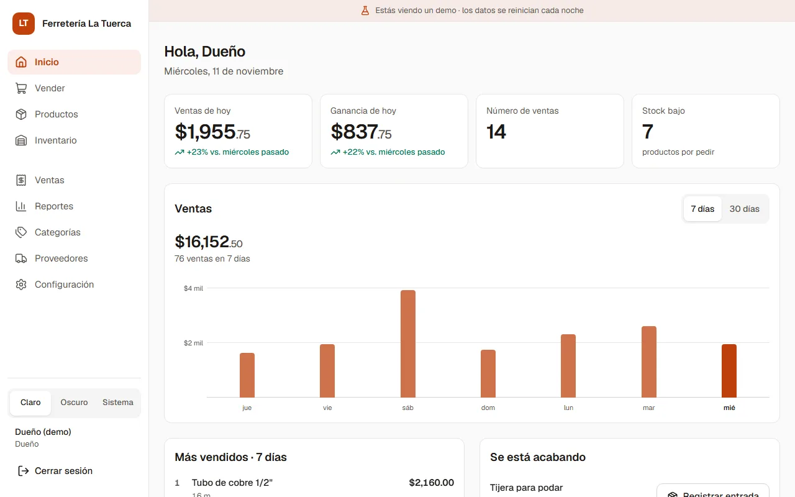
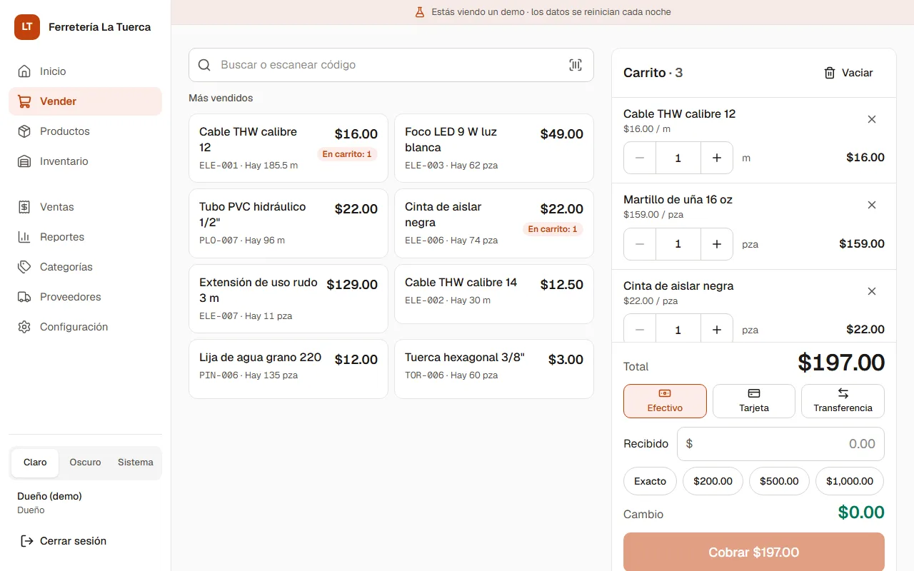
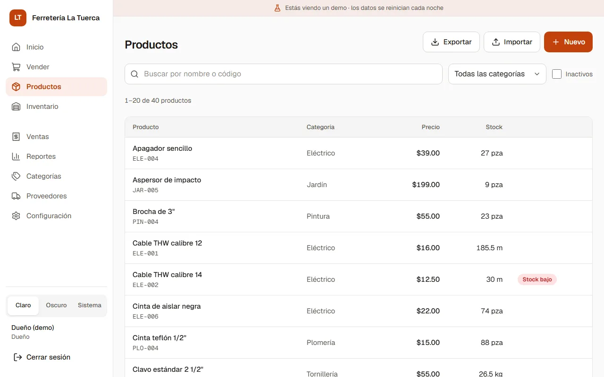
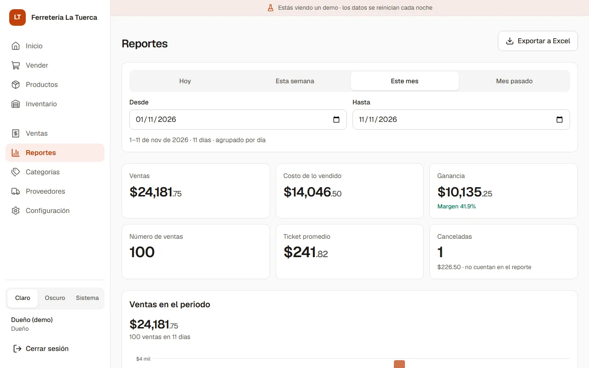
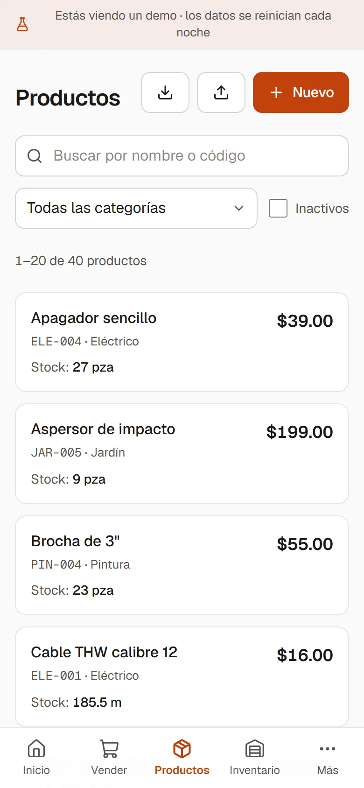
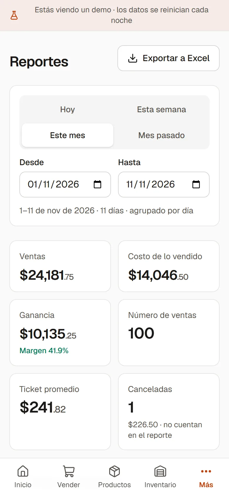
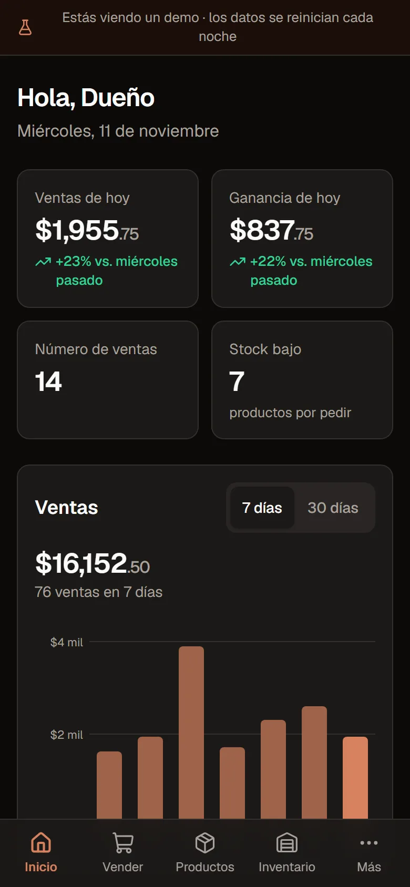

# Inventario POS

Sistema de **inventario y punto de venta** para un negocio local, pensado para usarse desde el celular o la tablet. Esta es la versión demo, con un negocio ficticio: **Ferretería La Tuerca**.

**Demo:** https://inventario-pos-sepia.vercel.app — toca **"Entrar al demo como dueño"** o **"como cajero"**. Los datos se reinician cada noche.

<p>
  
  
  
</p>

## Qué hace

- **Vender:** buscador por nombre o código (un lector de barras funciona como teclado: código + Enter), carrito con cantidades por pieza, metro o kilo, cobro en efectivo, tarjeta o transferencia, y ticket para imprimir. Un cobro nunca se registra dos veces, aunque se caiga el internet a la mitad.
- **Inicio:** ventas y ganancia de hoy comparadas con el mismo día de la semana pasada, gráfica de 7 o 30 días, lo más vendido y lo que se está acabando.
- **Productos:** alta y edición con margen en vivo, importación desde Excel con vista previa y exportación.
- **Inventario:** entradas, mermas y ajustes por conteo, con historial filtrable. El stock solo cambia por funciones de la base que guardan el antes y el después.
- **Ventas y reportes:** cancelación con motivo (regresa el stock), reimpresión, reportes por rango (ventas, costo, ganancia, por categoría, por método, sin movimiento) y exportación a Excel.
- **Roles:** dueño (todo) y cajero (vender y consultar). El cajero nunca recibe costos ni ganancias: se valida en el servidor y en la base, no solo ocultando botones.
- **Marca del negocio:** nombre, logo y color desde Configuración; la app se ve como otro negocio sin tocar código. Modo claro, oscuro o el del sistema.

| Escritorio | |
|---|---|
|  |  |
|  |  |

<p>
  
  
  
</p>

## Stack

- **Next.js 16** (App Router, Server Components, Server Actions) con TypeScript.
- **Tailwind CSS v4** (tokens en `@theme`, sin `tailwind.config`).
- **Supabase:** Postgres, Auth y Storage. Las reglas de negocio viven en funciones SQL transaccionales y en RLS.
- **Vercel** para el deploy (Node 22).

## Seguridad

- **RLS en todas las tablas.** Ventas, detalle y movimientos no tienen políticas de escritura: solo se escriben con funciones `SECURITY DEFINER` que validan sesión, rol y stock, y bloquean los productos con `FOR UPDATE`.
- **Cada página valida la sesión en el servidor** (`verifySession()`), además del proxy.
- **Sin `service_role` en el día a día.** La app usa la publishable key y la sesión del usuario. La secret key es opcional y solo sirve para crear usuarios desde Configuración.
- **Content Security Policy con nonce** por petición: solo corren los scripts de la app (`'strict-dynamic'`, sin `'unsafe-inline'` ni `'unsafe-eval'` en producción). Además `X-Frame-Options`, `Referrer-Policy`, `nosniff` y `Permissions-Policy`.
- **Credenciales del demo solo en el servidor:** el botón "Entrar al demo" inicia sesión desde una Server Action; el navegador nunca ve la contraseña.

## Correr en local

```bash
npm install
cp .env.example .env.local   # y llena los valores (ver abajo)
npm run dev                  # http://localhost:3000
```

| Variable | Para qué |
|---|---|
| `NEXT_PUBLIC_SUPABASE_URL` | URL del proyecto de Supabase. |
| `NEXT_PUBLIC_SUPABASE_PUBLISHABLE_KEY` | Publishable key (pública por diseño; RLS protege los datos). |
| `DEMO_MODE` | `true` solo en el demo: muestra los botones de demo y el banner. Para un cliente, vacía. |
| `DEMO_DUENO_EMAIL`, `DEMO_DUENO_PASSWORD`, `DEMO_CAJERO_EMAIL`, `DEMO_CAJERO_PASSWORD` | Solo en el demo. Nunca con prefijo `NEXT_PUBLIC_`. |
| `CRON_SECRET` | Opcional. Protege `/api/vida`, que Vercel Cron llama una vez al día para que Supabase no pause el proyecto. |
| `SUPABASE_SECRET_KEY` | Opcional, solo servidor. Permite crear usuarios desde Configuración > Usuarios. Sin ella, los usuarios se crean en el panel de Supabase. |

## Instalar para un cliente nuevo

Los scripts están en [`docs/sql/`](docs/sql/), numerados. Se corren en el **SQL Editor** de Supabase, uno por uno y en este orden. Todos son idempotentes.

1. En Supabase:
   - **Authentication > Sign In / Providers:** desactiva *Allow new users to sign up* (los usuarios los da de alta el dueño).
   - **Authentication > URL Configuration:** pon la URL de Vercel como *Site URL*.
2. Corre los scripts de instalación:

   | # | Script | Qué hace |
   |---|---|---|
   | 1 | `01-esquema.sql` | Tablas, restricciones e índices |
   | 2 | `02-perfiles-y-roles.sql` | Roles y perfil automático de cada usuario nuevo |
   | 3 | `03-rls-y-permisos.sql` | Permisos y políticas RLS |
   | 4 | `04-funciones-inventario.sql` | Movimientos de inventario |
   | 5 | `05-funciones-ventas.sql` | Cobrar y cancelar ventas |
   | 6 | `06-vistas.sql` | Vistas (stock bajo, más vendidos) |
   | 7 | `09-crear-producto.sql` | Alta de producto con stock inicial |
   | 8 | `11-color-primario.sql` | Color de marca por defecto |
   | 9 | `12-venta-idempotente.sql` | Cobro sin duplicados |
   | 10 | `14-movimiento-idempotente.sql` | Movimientos sin duplicados |
   | 11 | `16-inicio.sql` | Indicadores de Inicio |
   | 12 | `20-costos-solo-dueno.sql` | Costos y ganancias solo para el dueño |
   | 13 | `22-folios-consecutivos.sql` | Folios sin huecos |
   | 14 | `24-ventas-y-reportes.sql` | Reportes |
   | 15 | `26-importar-productos.sql` | Importar desde Excel |
   | 16 | `28-roles-y-marca.sql` | Usuarios, marca y bucket del logo |
   | 17 | `30-pulido.sql` | Stock bajo por urgencia y "sin movimiento" |

   **No se corren** para un cliente: `07-semilla.sql` (datos de la ferretería ficticia: borra y recarga todo), `18-modo-demo.sql` (reinicio nocturno y usuarios demo) ni ninguna prueba (`08`, `10`, `13`, `15`, `17`, `19`, `21`, `23`, `25`, `27`, `29` y `31`).
3. Crea al dueño en **Authentication > Users > Add user** (correo y contraseña). Nace como cajero inactivo.
4. Vuélvelo dueño y carga los datos del negocio (cambia el correo, el nombre y el color):

   ```sql
   do $$
   begin
     -- Primer dueño: el usuario que creaste en Authentication > Users.
     update public.perfiles p
        set rol = 'dueno', activo = true, nombre = 'Nombre del dueño'
       from auth.users u
      where u.id = p.id and u.email = 'dueno@ejemplo.test';
     if not found then
       raise exception 'No encontré a dueno@ejemplo.test: créalo primero en Authentication > Users.';
     end if;

     -- Datos del negocio (una sola fila, id = 1). Después se cambian desde
     -- Configuración > Negocio y marca.
     insert into public.configuracion_negocio (id, nombre, giro, color_primario)
     values (1, 'Ferretería Ejemplo', 'Ferretería', '#1e3a8a')
     on conflict (id) do update
       set nombre = excluded.nombre, giro = excluded.giro, color_primario = excluded.color_primario;
   end $$;
   ```

5. En Vercel, configura `NEXT_PUBLIC_SUPABASE_URL` y `NEXT_PUBLIC_SUPABASE_PUBLISHABLE_KEY` (y, si quieres, `CRON_SECRET`). Deja `DEMO_MODE` vacía.
6. El dueño entra, sube su logo y su lista de productos desde Excel. Los demás usuarios se crean en Supabase (nacen como cajeros inactivos) y el dueño los activa en **Configuración > Usuarios**.

### Pruebas de la base

Cada script de pruebas corre dentro de `BEGIN … ROLLBACK` y no deja cambios, pero **necesita los datos de la semilla del demo** (`07`). Córrelas en una copia de prueba con `07` cargado, **nunca en la base de un cliente**.

## Documentación

- [`docs/00-plan-general.md`](docs/00-plan-general.md): objetivo de la demo, alcance, modelo de datos y estado de cada fase.
- `docs/fase-N-*.md`: qué se hizo en cada fase, decisiones, cómo se probó y resultados.
